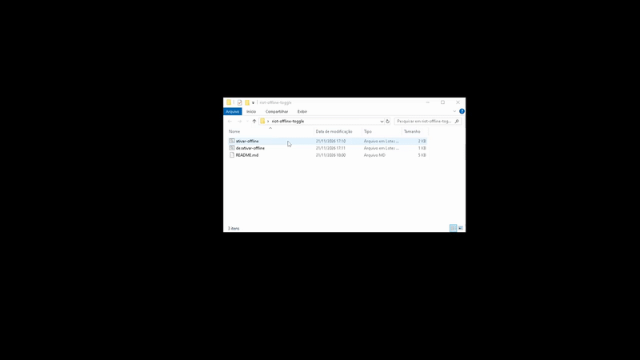
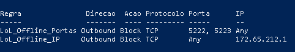

# Riot Offline Toggle

Ferramenta desenvolvida em **Batch Script (`.bat`)** para automatizar o bloqueio e a restauração de conexões de rede utilizadas pelos serviços sociais da Riot Games, permitindo jogar sem aparecer online na lista de amigos em ambientes testados.

O projeto utiliza o **Firewall do Windows** para gerenciar regras de tráfego de saída, sem modificar arquivos dos jogos ou do Riot Client.

> **Aviso:** Este é um projeto independente, sem vínculo com a Riot Games. Seu funcionamento pode ser afetado por atualizações dos clientes, alterações na infraestrutura de rede ou diferenças entre ambientes.

## Funcionalidades

- Ativação e desativação do bloqueio por meio de scripts `.bat`.
- Criação e remoção automatizada de regras no Firewall do Windows.
- Bloqueio de conexões TCP destinadas às portas remotas `5222` e `5223`.
- Resolução dinâmica do endereço IPv4 de um servidor de chat da Riot.
- Verificação de privilégios administrativos antes da execução.
- Remoção de regras anteriores para evitar duplicações.
- Tratamento de falhas na configuração das regras.

## Requisitos

- Windows com o Firewall do Windows habilitado.
- Permissões de administrador.
- Riot Client instalado.

## Como utilizar

### Ativar o modo offline

1. Feche o Riot Client e os jogos da Riot.
2. Execute `ativar-offline.bat` como administrador.
3. Aguarde a criação das regras de firewall.
4. Reinicie o Riot Client e abra o jogo desejado.

### Desativar o modo offline

1. Execute `desativar-offline.bat` como administrador.
2. Aguarde a remoção das regras de firewall.
3. Reinicie o Riot Client para restabelecer a conectividade dos serviços sociais.

### Demonstração

> **Nota:** Os breves intervalos de tela preta correspondem às solicitações de elevação de privilégios do Controle de Conta de Usuário (UAC) do Windows, que não são capturadas durante a gravação.

## Funcionamento técnico

O projeto utiliza o comando `netsh advfirewall` para configurar regras de bloqueio de tráfego de saída no Firewall do Windows.

Durante a ativação, o script realiza as seguintes operações:

1. **Verificação de privilégios:** utiliza `fltmc` para verificar se a execução possui permissões administrativas.
2. **Limpeza de regras anteriores:** remove regras com os mesmos nomes antes de criar novas configurações.
3. **Bloqueio por portas:** cria uma regra para bloquear conexões TCP de saída destinadas às portas `5222` e `5223`.
4. **Resolução de endereço:** consulta `br.chat.si.riotgames.com` para identificar seu endereço IPv4.
5. **Bloqueio por IP:** quando a resolução é bem-sucedida, cria uma regra adicional para o endereço identificado.

Caso a resolução IPv4 falhe, o script informa a ocorrência e mantém somente o bloqueio por portas.

O script de desativação remove as regras configuradas, incluindo uma regra IPv6 utilizada em uma versão anterior do projeto.

### Regras de firewall

| Regra | Configuração | Finalidade |
|---|---|---|
| `LoL_Offline_Portas` | TCP, saída, portas remotas `5222, 5223` | Bloquear conexões destinadas às portas utilizadas pelo serviço de chat. |
| `LoL_Offline_IP` | TCP, saída, IPv4 resolvido dinamicamente | Bloquear conexões destinadas ao endereço identificado. |

A versão atual não cria regras de bloqueio para faixas IPv6, evitando restrições excessivas sobre endereços que podem ser compartilhados com outros serviços.

### Verificação das regras

As regras criadas podem ser consultadas utilizando o PowerShell e os cmdlets de gerenciamento do Firewall do Windows.

A captura abaixo apresenta as configurações observadas durante o teste, incluindo direção, ação, protocolo, portas e endereço IP de destino.

No ambiente testado, foram identificadas duas regras de saída com ação `Block`: uma para as portas TCP `5222` e `5223` e outra para o IPv4 `172.65.212.1`, resolvido durante a execução.

O endereço IP apresentado corresponde à resolução observada naquele momento e pode mudar em execuções futuras.

## Testes e validação

O funcionamento foi avaliado manualmente em ambiente Windows, comparando o comportamento dos serviços sociais da Riot com as regras de firewall ativadas e desativadas.

Para validar o resultado externamente, foi utilizada uma **segunda conta no Riot Mobile**, permitindo verificar como a conta principal aparecia para outro usuário.

### Teste 01 — Bloqueio ativado

Após executar `ativar-offline.bat` e reiniciar os clientes, foram observados os seguintes comportamentos:

- O Riot Client exibiu a conta principal como `Offline`.
- O League of Legends permaneceu aberto, mas apresentou desconexão do serviço de chat.
- A segunda conta, acessada pelo Riot Mobile, visualizou a conta principal como `Offline`.

**Cliente no Windows**

**Verificação pelo Riot Mobile**

### Teste 02 — Bloqueio desativado

Após executar `desativar-offline.bat` e reiniciar os clientes, foram observados os seguintes comportamentos:

- O Riot Client voltou a exibir a conta principal como `Online`.
- A conexão social do League of Legends foi restabelecida.
- A segunda conta, acessada pelo Riot Mobile, visualizou a conta principal como `Online - League of Legends`.

**Cliente no Windows**

**Verificação pelo Riot Mobile**

### Resultado dos testes

| Verificação | Bloqueio ativado | Bloqueio desativado |
|---|---|---|
| Regras de bloqueio | Aplicadas | Removidas |
| Riot Client | Offline | Online |
| Chat do League of Legends | Desconectado | Conectado |
| Visibilidade no Riot Mobile | Offline | Online — League of Legends |

Os resultados demonstram o comportamento observado durante os testes realizados, sem garantir o mesmo funcionamento em todos os ambientes.

### Outros jogos testados

Além do League of Legends, o projeto também foi testado manualmente com:

- Valorant
- Teamfight Tactics (TFT)

Nos testes anteriores, foi possível utilizar esses jogos sem aparecer online na lista de amigos. As evidências visuais apresentadas nesta documentação, entretanto, correspondem especificamente à validação realizada com o **League of Legends e o Riot Mobile**.

## Limitações e cuidados

- **Escopo das regras:** o bloqueio é aplicado ao sistema operacional, não exclusivamente aos processos da Riot. Outros aplicativos que utilizem as mesmas portas ou endereços podem ser afetados.
- **Alterações de endereço IP:** o IPv4 do servidor é consultado durante a ativação. Caso o endereço mude posteriormente, pode ser necessário executar o script novamente.
- **Dependência da resolução DNS:** se o endereço IPv4 não puder ser identificado, somente o bloqueio por portas será aplicado.
- **IPv6:** a versão atual não cria uma regra específica de bloqueio IPv6, o que pode limitar sua eficácia em determinados ambientes.
- **Atualizações dos serviços:** mudanças no Riot Client ou na infraestrutura da Riot podem alterar as conexões utilizadas e afetar o funcionamento.
- **Visibilidade:** o projeto não garante invisibilidade em todos os serviços, jogos ou situações.
- **Políticas de uso:** a compatibilidade da ferramenta com as políticas da Riot Games não foi verificada.

## Tecnologias utilizadas

| Tecnologia | Aplicação no projeto |
|---|---|
| Batch Script | Automação de comandos e controle de execução no Windows |
| Windows Defender Firewall | Gerenciamento de regras de tráfego de saída |
| Netsh | Criação e remoção de regras de firewall |
| TCP/IP | Identificação e bloqueio de conexões de rede |
| DNS | Resolução de nomes de domínio para endereços IPv4 |
| PowerShell | Inspeção e validação das regras configuradas |

## Desenvolvimento

A implementação inicial foi gerada com auxílio de inteligência artificial. Posteriormente, os scripts foram analisados, testados e revisados para melhorar o gerenciamento das regras de firewall, a verificação de privilégios administrativos e o tratamento de erros.

O projeto foi utilizado como exercício prático de **redes de computadores, administração do Windows, automação e validação de configurações de firewall**.

A documentação inclui evidências da execução dos scripts, inspeção das regras criadas e testes comparativos de conectividade realizados com duas contas Riot.
